# TIBRA NATURALS – SEO System Architecture & Growth Model

**Official Brand:** TIBRA NATURALS  
**Primary Canonical Domain:** `https://www.tibranaturals.com/`  
**Architecture Model:** Technical Crawlability, Semantic Head Engine, Topic Clustering, and Conversion Funnels.

---

## 1. High-Level SEO Architecture Diagram

```mermaid
graph TD
  A["TIBRA NATURALS<br/>https://www.tibranaturals.com/"] --> B["Technical SEO Foundation"]
  A --> C["On-Page & Keyword Strategy"]
  A --> D["Product & Category SEO"]
  A --> E["Content Marketing & Blog"]
  A --> F["Structured Data & Schemas"]
  A --> G["Local & Domestic (Pakistan)"]
  A --> H["Google Search Console & GA4"]

  B --> B1["robots.txt Directives"]
  B --> B2["Dynamic sitemap.xml"]
  B --> B3["Self-Referencing Canonicals"]
  B --> B4["Core Web Vitals & Image Optimization"]

  C --> C1["Unique Meta Titles & Descriptions"]
  C --> C2["Single H1 & Semantic H2/H3"]
  C --> C3["Internal Linking Mesh"]

  D --> D1["Pain Relief Oil (/products/pain-relief-oil/)"]
  D --> D2["Verified Botanical Ingredients (/ingredients/)"]
  D --> D3["Daily Application Ritual (/how-to-use/)"]
  D --> D4["Quality & Extraction (/our-quality/)"]

  E --> E1["Herbal Massage Oil Guide"]
  E --> E2["Natural Oils & Personal Care"]
  E --> E3["Understanding Herbal Ingredients"]
  E --> E4["Safe Use & Topical Precautions"]

  F --> F1["Organization & Brand Schema"]
  F --> F2["WebSite & BreadcrumbList"]
  F --> F3["Product & InStock Offer"]
  F --> F4["Article & FAQPage Schemas"]

  G --> G1["Pakistan COD Intent & Regional Logistics"]
  G --> G2["Roman Urdu & Conversational Keywords"]
  G --> G3["Local Currency PKR Rs. 1,500 / Rs. 2,600"]

  H --> H1["Domain Verification DNS TXT"]
  H --> H2["GA4 E-Commerce Events (add_to_cart, purchase)"]
  H --> H3["URL Inspection & Indexing Monitoring"]

  B1 & C1 & D1 & E1 & F1 & G1 & H1 --> I["Organic Search Visibility"]
  I --> J["Qualified Buyer Traffic"]
  J --> K["Direct Orders & WhatsApp Conversions"]
```



---

## 2. Technical Component Layering

| Component | Physical File Path | Purpose in SEO Architecture |
| :--- | :--- | :--- |
| **Brand Config** | `src/config/brandConfig.ts` | Single source of truth for canonical domains, official name, and metadata defaults. |
| **SEO Head Manager** | `src/components/SeoHead.tsx` | Dynamically injects title, meta descriptions, canonical URLs, OG/Twitter tags, and JSON-LD per route. |
| **Robots Directive** | `public/robots.txt` | Governs search engine crawler access; protects `/admin` while announcing `sitemap.xml`. |
| **XML Sitemap** | `public/sitemap.xml` | Machine-readable index of all canonical, indexable URLs with authentic last-modified timestamps. |
| **Router Engine** | `src/context/ShopContext.tsx` | HTML5 pushState routing supporting clean URLs for product, blog, ingredients, and policy pages. |
| **Analytics Engine** | `src/services/analyticsService.ts` | Dispatches standardized GA4 e-commerce events (`view_item`, `add_to_cart`, `purchase`). |

---

## 3. Organic Growth Funnel

```
               [ TOP OF FUNNEL: Informational Searches ]
   "How to use herbal massage oil", "Turmeric and Ginger for joints"
                                │
                                ▼
        [ Content Hub & Guides: /blog/ & /ingredients/ ]
       Educational trust building, zero false medical claims
                                │
                                ▼
            [ MIDDLE OF FUNNEL: Commercial Intent ]
       "Pain relief oil Pakistan", "Herbal joint massage oil"
                                │
                                ▼
       [ Core Product Landing: /products/pain-relief-oil/ ]
       Verified 30ml amber bottle, formula, pricing (Rs. 1,500 / Rs. 2,600)
                                │
                                ▼
           [ BOTTOM OF FUNNEL: Checkout & Conversion ]
         Nationwide Cash on Delivery (COD) / Direct WhatsApp
```
